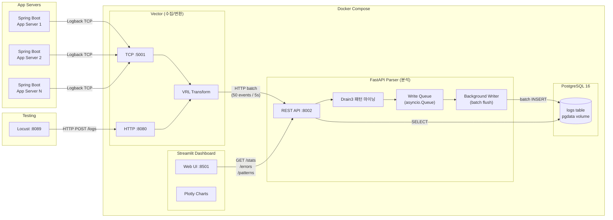
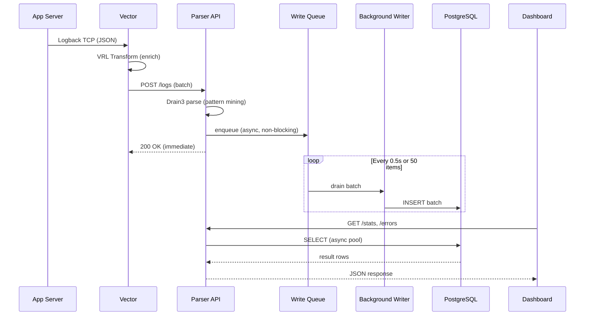

# Architecture

## System Overview



## VRL (Vector Remap Language)

Vector에서 로그 데이터를 변환/가공할 때 사용하는 스크립트 언어입니다. `vector.toml`의 `transforms` 섹션에서 사용됩니다.

```toml
[transforms.enrich_logback]
type = "remap"
source = '''
.source = "logback"        # 로그 출처 표시 필드 추가
.processed_at = now()       # Vector 처리 시점 타임스탬프 추가
'''
```

필드 추가, 삭제, 변환, 조건 분기 등을 지원하며, Vector 파이프라인 내에서 로그를 정제하는 역할을 합니다.

## Data Flow



## Port Map

| Service | Container Port | Host Port | Purpose |
|---------|---------------|-----------|---------|
| PostgreSQL | 5432 | 5432 | Database |
| Parser | 8000 | 8002 | REST API |
| Vector | 5000 | 5001 | Logback TCP |
| Vector | 8080 | 8080 | HTTP (test) |
| Vector | 8686 | 8686 | Vector API |
| Dashboard | 8501 | 8501 | Web UI |
| Locust | 8089 | 8089 | Load test UI (local) |

## Write Queue Design

```
POST /logs → parse → queue.put() → return 200
                         │
                         ▼
              ┌─────────────────────┐
              │   asyncio.Queue     │
              │   (in-memory)       │
              └────────┬────────────┘
                       │
                       ▼  every 0.5s or 50 items
              ┌─────────────────────┐
              │  Background Writer  │
              │  executemany()      │
              └────────┬────────────┘
                       │
                       ▼
              ┌─────────────────────┐
              │    PostgreSQL       │
              │    (asyncpg pool)   │
              │    min=2, max=10    │
              └─────────────────────┘
```

- POST /logs는 큐에 넣고 즉시 응답 (non-blocking)
- Writer가 0.5초 간격 또는 50건 단위로 배치 INSERT
- 프로세스 크래시 시 큐 데이터 유실 가능 (로그 분석 도구이므로 허용)
